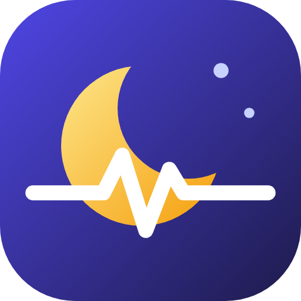
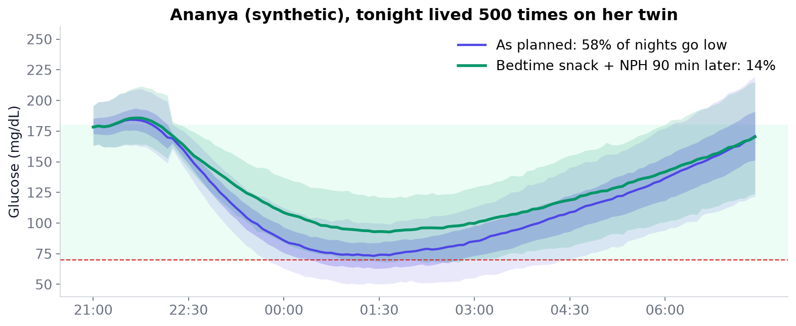
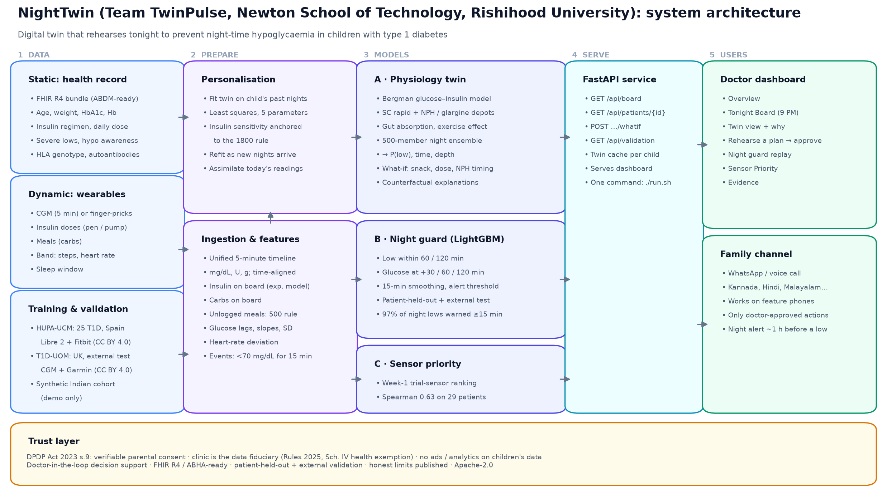
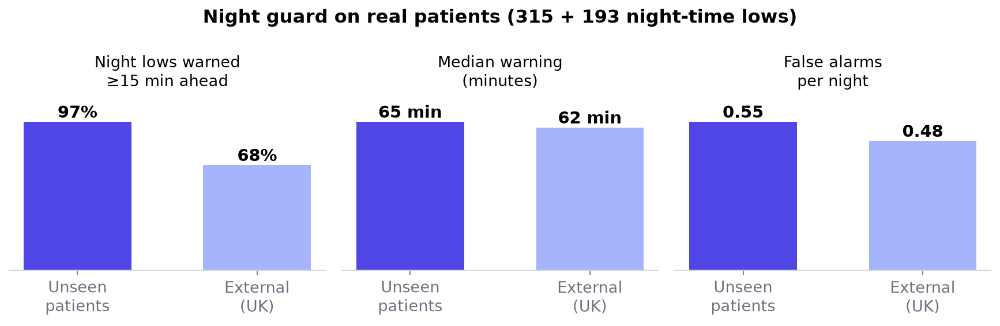
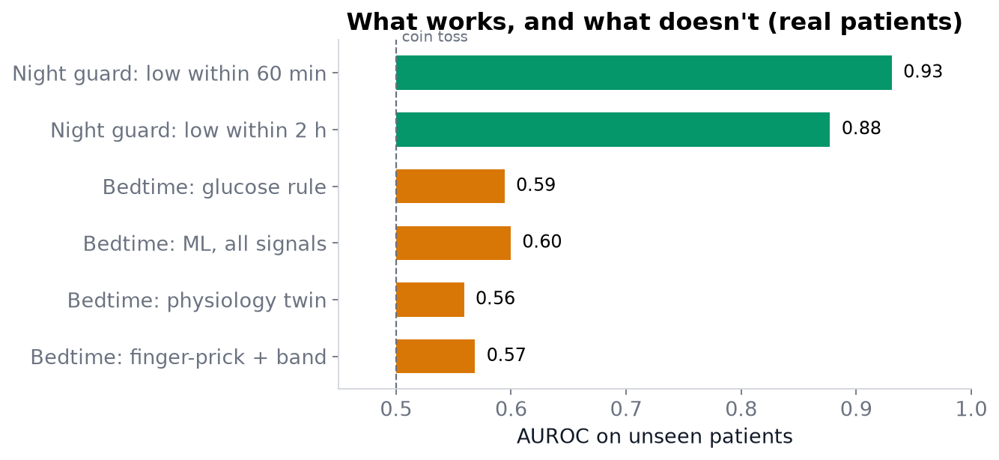

<p align="center"></p>

# NightTwin: the twin lives the night first

**By Team TwinPulse · Newton School of Technology, Rishihood University**

A physiology-based digital twin that rehearses tonight to prevent night-time hypoglycaemia in Indian children with type 1 diabetes. Submission for the **Happiest Health Digital Twin Challenge 2026**.

> **Live demo (no install):** https://manangilhotra.github.io/TwinPulse_NewtonSchoolOfTechnology_RishihoodUniversity/
> The twin runs in your browser: open a child, rehearse a plan, and watch the night re-simulate.

## Submission checklist

| Required item | Where |
|---|---|
| Team details | [§1](#1-team-details) |
| College / incubator information | [§2](#2-college--incubator-information) |
| Project title | [§3](#3-project-title) |
| Problem statement | [§4](#4-problem-statement) |
| Healthcare use case | [§5](#5-healthcare-use-case) |
| Technical stack | [§6](#6-technical-stack) |
| AI/ML model and framework details | [§7](#7-aiml-model-and-framework-details) |
| Demo video (20 min) | [§8](#8-demo-video) |
| Open-source licence | [§9](#9-open-source-licence) |
| Architecture diagram (PDF/PPT) | [§10](#10-architecture-diagram) |
| Presentation (PDF/PPT) with project details and outcomes | [§11](#11-presentation) |
| All files and links public | [§12](#12-public-access) |

## 1. Team details

| Team name | Member | Role |
|---|---|---|
| **TwinPulse** | **Manas Saxena** | Team leader |
| | **Manan Gilhotra** | Team member |

## 2. College / incubator information

**Newton School of Technology, Rishihood University**

## 3. Project title

**NightTwin: a physiology-based digital twin that rehearses tonight to prevent night-time hypoglycaemia in Indian children with type 1 diabetes**

## 4. Problem statement

- **India has more children with type 1 diabetes (T1D) than any other country:** 2.29 lakh under 20 (IDF Diabetes Atlas 2021). The 2025 Atlas counts 9.4 lakh Indians with T1D.
- **Insulin keeps them alive, and its most feared side effect is hypoglycaemia (low blood sugar).**
  - In the DCCT trial, 55% of severe lows happened during sleep.
  - "Dead-in-bed" syndrome, thought to follow severe night lows, is linked to about 5–6% of deaths in people with T1D under 40.
- **A CGM with low alarms costs about ₹4,000–4,700 per 14-day sensor** (₹1.1–1.2 lakh a year). Most families use finger-pricks and set a 2 AM alarm.
- **Timing makes it worse:** the cheaper human NPH insulin many programmes supply peaks between 1 and 4 AM.
- **No clinic tool says which nights are dangerous**, and a doctor cannot safely test a change in insulin or routine before the child lives through it.

**Why type 1 diabetes fits the brief.** Diabetes is India's most prevalent chronic disease, and hypoglycaemia is the deadliest *acute* adverse event of its treatment. We start with the group that has the least protection; the same twin extends directly to adults with type 2 diabetes on insulin or sulfonylureas. Insulin-treated diabetes is also where "simulating a patient's unique physiology" is best established: the UVA/Padova glucose–insulin simulator was accepted by the US FDA in 2008 as a substitute for animal trials in testing insulin treatments.

## 5. Healthcare use case

A paediatric diabetes clinic (district hospital, state programme or NGO) looks after hundreds of children. NightTwin gives it four tools:

1. **Tonight Board.** At 9 PM, every child's twin "lives tonight" 500 times. Children are ranked by their risk of a night low, so the educator knows whom to call before bed.
2. **Rehearse a plan.** The doctor tries a change on the twin and sees the night's risk move *before* prescribing it: a bedtime snack, a smaller dinner dose after a sports day, or moving NPH from dinner to bedtime. The approved plan goes to the family in their language.
3. **Night guard (CGM families).** A real-time model warns about an hour before a low and calls the parent. Voice calls work on feature phones.
4. **Sensor Priority (finger-prick families).** A 14-day trial sensor ranks which children will have the most night lows, so a programme's scarce CGMs go to those who need them most.

**Adverse event predicted:** a night-time low (glucose below 70 mg/dL for 15+ minutes), warned up to 2 hours in advance.

## 6. Technical stack

| Layer | Technology |
|---|---|
| Language and data | Python 3.12, pandas, NumPy, SciPy |
| Physiology twin engine | numba (compiled simulator), SciPy least-squares fitting |
| Machine learning | LightGBM, scikit-learn |
| API | FastAPI, Uvicorn |
| Dashboard | React 18, Vite, Recharts; JavaScript port of the twin ([dashboard/src/twin.js](dashboard/src/twin.js)) for the in-browser live demo |
| Health records | FHIR R4 JSON (ABDM/ABHA-ready) |
| Hosting | GitHub Pages (live demo) |
| Testing | pytest |
| Documents | matplotlib (figures, architecture PDF), pptxgenjs (presentation) |

## 7. AI/ML model and framework details

| Model | What it does | Method | Validation |
|---|---|---|---|
| **A. Physiology twin** | Simulates tonight 500 times per child; what-if rehearsal; counterfactual explanations | Bergman minimal model extended with subcutaneous rapid and long-acting (NPH/glargine) insulin depots, gut carbohydrate absorption and a 4-hour exercise effect. Personalised per child by least squares on past nights, with insulin sensitivity anchored to the 1800 rule. 500-member Monte Carlo ensemble | Walk-forward on real nights |
| **B. Night guard** | Predicts a low within 60 / 120 minutes; forecasts glucose at +30/60/120 min | LightGBM gradient-boosted trees on glucose lags and slopes, insulin and carbs on board, steps, heart-rate deviation and time of day; 15-minute risk smoothing | 5-fold patient-held-out (HUPA-UCM) + external test (T1D-UOM) |
| **C. Sensor priority** | Ranks which children need a CGM most | Week-1 time-below-range ranking | Spearman 0.63 on 29 real patients |

**Key results on real patients the models never saw:** 97% of 315 night-time lows were warned ≥15 min ahead, with a median warning of 65 min and 0.55 false alarms per night. On the external UK test: 68%, 62 min and 0.48. Full results are in [Results](#results-real-patients-only).

## 8. Demo video

- **Watch the demo video (20 min):** https://drive.google.com/file/d/1uBdDl5HqWk8Q1doEUQR98Sl6v-LR-ojV/view?usp=sharing
- Direct download (same video, 1080p): [NightTwin_Walkthrough.mp4](https://github.com/MananGilhotra/TwinPulse_NewtonSchoolOfTechnology_RishihoodUniversity/releases/download/v1.0/NightTwin_Walkthrough.mp4)
- Script with on-screen cues: [docs/VIDEO_SCRIPT.md](docs/VIDEO_SCRIPT.md)

**What the video covers:**
- the problem and the idea
- how we meet the brief
- the architecture and the physiology twin
- a recorded live demo of every dashboard feature
- results on real patients, including what did not work
- privacy and DPDP compliance
- impact and limitations

## 9. Open-source licence

**Apache License 2.0**. See [LICENSE](LICENSE). The datasets used are CC BY 4.0 (see [Data](#data-sandbox-rules-open-and-synthetic-only)).

## 10. Architecture diagram

- **PDF:** [docs/TwinPulse_Architecture.pdf](docs/TwinPulse_Architecture.pdf)
- A preview is in the [Architecture](#architecture) section below.

## 11. Presentation

- **PDF:** [docs/TwinPulse_Presentation.pdf](docs/TwinPulse_Presentation.pdf)
- **PPT:** [docs/TwinPulse_Presentation.pptx](docs/TwinPulse_Presentation.pptx)

**18 slides covering:**
- the problem and the solution
- data fusion and the architecture
- the twin and the live demo
- results and outcomes
- privacy, impact and limitations

## 12. Public access

This repository, the live demo (https://manangilhotra.github.io/TwinPulse_NewtonSchoolOfTechnology_RishihoodUniversity/), the release video and all documents are public and need no login or permissions.

---

# Project details

> **Live demo (no install):** https://manangilhotra.github.io/TwinPulse_NewtonSchoolOfTechnology_RishihoodUniversity/
> Open a child, rehearse a plan, and watch the night re-simulate in your browser.



## How the data streams are fused

| Static / historical (health record) | Dynamic / real-time (wearables) |
|---|---|
| FHIR R4 bundle (ABDM-ready): age, weight, HbA1c, haemoglobin (anaemia flag), insulin regimen and daily dose, past severe lows, hypo awareness, **HLA genotype and islet autoantibodies (genetic markers)**, strips per day, parental consent | CGM every 5 min **or** finger-pricks, insulin doses (pen/pump), meals (carbs), steps and heart rate from a band, sleep window |

The record **parameterises** the twin: daily dose sets insulin sensitivity, the regimen sets the insulin action profile, and the hypo-awareness flag is shown with the risk. The wearable stream **drives and corrects** it every five minutes.

## Architecture



**Physiology twin** ([twinpulse/twin.py](twinpulse/twin.py)): a Bergman-type glucose–insulin model.
- **What it models:** subcutaneous rapid insulin and long-acting insulin (NPH or glargine), gut carbohydrate absorption, and an exercise effect that lingers about 4 hours (the "evening cricket, 2 AM low" pattern). Numerical core in `numba`.
- **Personalisation:** fitted per child by least squares on their own previous nights, with insulin sensitivity anchored to the clinical 1800 rule. Unlogged meals are inferred from mealtime insulin with the 500 rule.
- **Bedtime run:** it assimilates the day's glucose readings, then runs freely from 23:00 as a **500-member ensemble**. Output: probability, likely time and depth of a low.
- **Explanations:** counterfactual. The twin removes one factor at a time (evening play, dinner insulin, NPH) and reports how much the risk falls.

**Night guard** ([scripts/train.py](scripts/train.py)): LightGBM models that predict a low within 60 or 120 minutes, and glucose at +30, +60 and +120 minutes.
- **Inputs:** glucose lags and slopes, insulin and carbs on board, steps, heart-rate deviation, time of day.
- **Alerting:** risk is smoothed over 15 minutes before an alert fires.

**Service and UI:** FastAPI ([api/main.py](api/main.py)) and a React + Recharts doctor dashboard ([dashboard/](dashboard/)). Pages: Overview, Tonight Board, Twin view, Rehearse, Night guard replay, Sensor Priority, Evidence, Privacy & India.

## Data (sandbox rules: open and synthetic only)

| Data | Contents | Use | Licence |
|---|---|---|---|
| [HUPA-UCM](https://data.mendeley.com/datasets/3hbcscwz44/1) (Spain) | 25 people with T1D: FreeStyle Libre 2 CGM, Fitbit heart rate/steps, insulin, carbs | Training + patient-held-out validation | CC BY 4.0 |
| [T1D-UOM](https://doi.org/10.5281/zenodo.15806142) (UK) | T1D, about 3 months each: CGM, pump and injected insulin, food, Garmin activity/heart rate, sleep | External test (different devices) | CC BY 4.0 |
| Synthetic Indian cohort ([twinpulse/synth.py](twinpulse/synth.py)) | 12 children × 14 days, Indian routines, NPH/premixed/glargine regimens, FHIR R4 records | **Dashboard demo only, never used for scoring** | Generated |

## Results (real patients only)

Patients were split into 5 groups, so every score is on people the model never saw. T1D-UOM is an independent external test.



| Night guard, counted per night-time low (alert threshold 0.2) | Unseen patients | External (UK) |
|---|---|---|
| Night lows warned ≥15 min ahead | **97%** (315 lows) | 68% (193 lows) |
| Median warning | **65 min** | 62 min |
| False alarms per night | 0.55 | 0.48 |
| AUROC, low within 60 min, 22:00–06:00 | **0.93** | 0.90 |
| AUROC, low within 2 h, 22:00–06:00 | **0.88** | 0.78 |

| Glucose forecast RMSE (mg/dL) | Assume no change | Extend trend | NightTwin | Clarke A+B |
|---|---|---|---|---|
| 30 min | 21.2 | 23.5 | **18.1** | 97.6% |
| 60 min | 34.8 | 44.9 | **30.4** | 94.4% |
| 2 h | 51.7 | 78.8 | **44.4** | 91.1% |

**Sensor priority:** time below range in a child's first week on a sensor ranks who will have the most night lows later.
- Spearman correlation: **0.63** across 29 real patients.
- Top third: **42%** of later nights had a low. Bottom third: **10%**.



**What did not work (reported honestly).**
- **Bedtime-only prediction is close to chance.** Predicting a low between 00:00 and 06:00 from information at 23:00 scored about 0.55–0.63 AUROC on 1,046 real nights, for every method: a glucose rule, ML on all signals, and the physiology twin.
- **So we changed the design.** The bedtime rehearsal is used to *compare plans*, not to promise a night is safe. Warnings come from the in-night guard.
- **Extra signals add little.** Insulin, meal, step and heart-rate features add about 0.01 AUROC over glucose alone in these datasets.

**How we meet the brief:**
- **Two fused streams:** a FHIR health record (demographics, diagnosis, labs, genetic markers) plus wearable time series (CGM, steps, heart rate).
- **An adverse event predicted in advance:** a night-time low, up to 2 hours ahead.
- **A doctor dashboard.**
- **Data:** only open or synthetic.

All numbers are regenerated by the scripts below. Raw outputs: [reports/metrics.json](reports/metrics.json), [reports/metrics_extra.json](reports/metrics_extra.json).

## Run it

**Fastest:** open the [live demo](https://manangilhotra.github.io/TwinPulse_NewtonSchoolOfTechnology_RishihoodUniversity/).

**Locally, one command** (needs Python 3.12 and Node 18+):

```bash
./run.sh
```

Then open http://localhost:8000. Trained models and the synthetic demo cohort are committed, so no download is needed.

**Tests:**

```bash
.venv/bin/python -m pytest -q
```

**Reproduce everything from the raw open data:**

```bash
.venv/bin/python scripts/download_data.py       # HUPA-UCM + T1D-UOM into data/raw/
.venv/bin/python scripts/build_features.py      # 5-min tables, nightly + real-time feature tables
.venv/bin/python scripts/train.py               # models/ + reports/metrics.json
.venv/bin/python scripts/eval_twin.py           # physiology twin, walk-forward bedtime test
.venv/bin/python scripts/evaluate_extra.py      # event-level guard, sensor ranking -> reports/metrics_extra.json
.venv/bin/python -m twinpulse.synth             # synthetic Indian demo cohort (data/demo/)
.venv/bin/python scripts/make_figures.py        # docs/figures/
.venv/bin/python scripts/make_architecture.py   # docs/TwinPulse_Architecture.pdf
./scripts/deploy_pages.sh                       # static live demo -> GitHub Pages (twin runs in the browser)
.venv/bin/python -m pip install -r requirements-video.txt && .venv/bin/python scripts/make_video.py   # produced walkthrough video (neural voices, recorded live demo, captions; app must be running)
```

**Development mode:** run `.venv/bin/uvicorn api.main:app --port 8000`, then `cd dashboard && npm install && npm run dev` (http://localhost:5173).

## Repository layout

```
api/                FastAPI service
dashboard/          React doctor dashboard
twinpulse/          data loading, features, physiology twin, synthetic cohort, service logic
scripts/            download, training, evaluation, figures, architecture diagram
tests/              pytest suite
models/             trained LightGBM models
data/demo/          synthetic Indian children (parquet + FHIR R4 bundles)
reports/            metrics (JSON)
docs/               architecture PDF, presentation (PDF/PPTX), figures, screenshots, video script
```

## Privacy, safety and India fit

- **DPDP Act 2023 (children's data):**
  - Section 9 requires verifiable parental consent and bars tracking or behavioural monitoring of children.
  - The DPDP Rules 2025 (Fourth Schedule) exempt clinical establishments and healthcare professionals when processing is limited to providing health services to the child.
  - NightTwin is therefore deployed by the clinic as data fiduciary. Parental consent is still recorded (a FHIR `Consent` resource), and there is no advertising or analytics.
- **Doctor in the loop:** the twin only shows simulated outcomes. The doctor approves every change, and families receive only approved actions.
- **Not a medical device:** this is decision support. A real deployment would follow CDSCO's medical device software pathway after a supervised pilot.
- **India fit:**
  - FHIR R4, ABHA-ready.
  - Models the human NPH/Regular and premixed insulin that programmes supply.
  - Indian routines: late dinners, evening play, school tiffin.
  - Alerts in Kannada, Hindi and Malayalam, including voice calls for feature phones.

## Limitations and next steps

- The models were trained on adults in Spain and validated on adults in the UK, not Indian children. **Next step:** a pilot with an Indian paediatric diabetes clinic, measuring night lows, parent sleep and false alarms.
- The demo children are synthetic.
- Translations are drafts for native-speaker review.
- Roadmap: extend the same twin to adults with type 2 diabetes on insulin or sulfonylureas.

## References

1. IDF Diabetes Atlas, 10th ed. (2021) and 11th ed. (2025), International Diabetes Federation.
2. DCCT Research Group. Epidemiology of severe hypoglycemia in the Diabetes Control and Complications Trial. *Am J Med* 1991. Reviewed in: Nocturnal Hypoglycemia in the Era of CGM, *PMC11418455*.
3. Hidalgo JI et al. HUPA-UCM diabetes dataset. *Data in Brief* 55 (2024) 110559.
4. Alsuhaymi A et al. A Longitudinal Multimodal Dataset of Type 1 Diabetes (T1D-UOM). *Scientific Data* 12, 1379 (2025).
5. Battelino T et al. International Consensus on Time in Range. *Diabetes Care* 2019.
6. Bergman RN et al. Quantitative estimation of insulin sensitivity (minimal model). *Am J Physiol* 1979.
7. Cappon G et al. ReplayBG: a digital twin-based methodology for T1D. *IEEE TBME* 2023 (methodological inspiration).
8. Cobelli C, Kovatchev B. Developing the UVA/Padova Type 1 Diabetes Simulator. *J Diabetes Sci Technol* 2023.
9. Digital Personal Data Protection Act 2023 and DPDP Rules 2025 (Fourth Schedule), Government of India.
